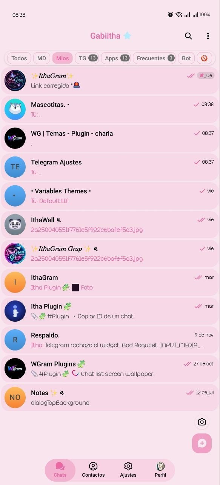
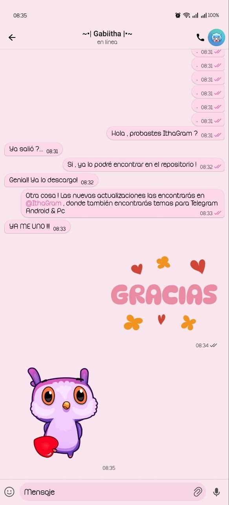
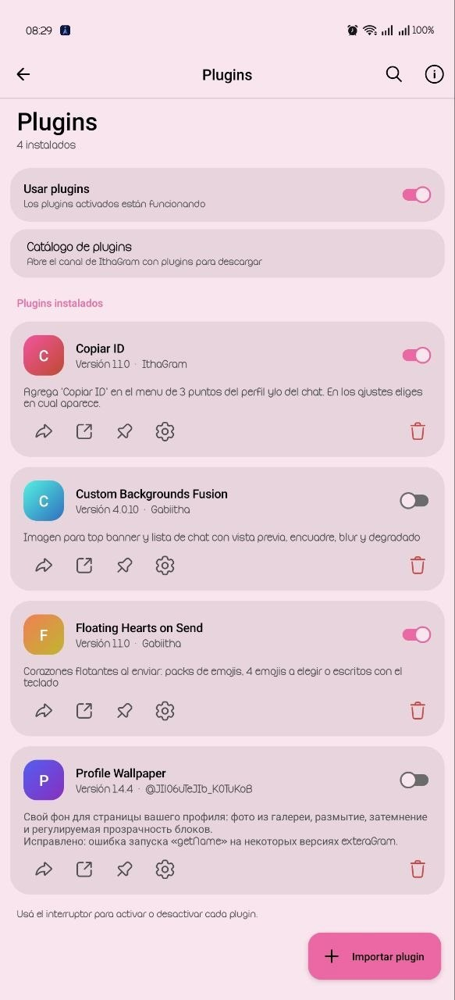
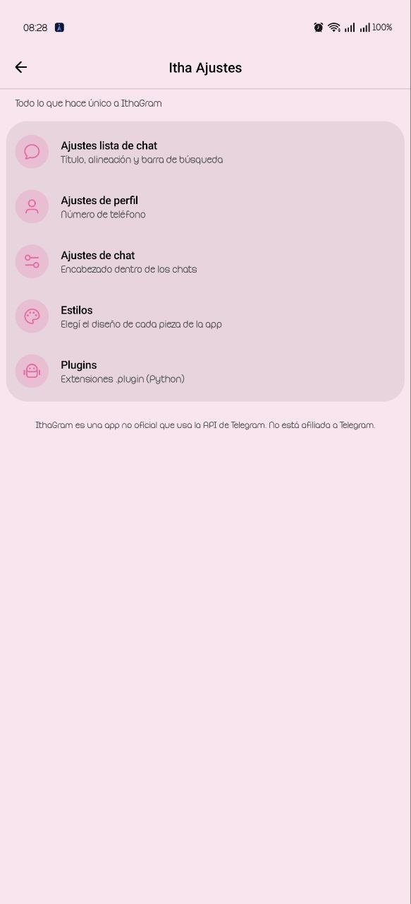
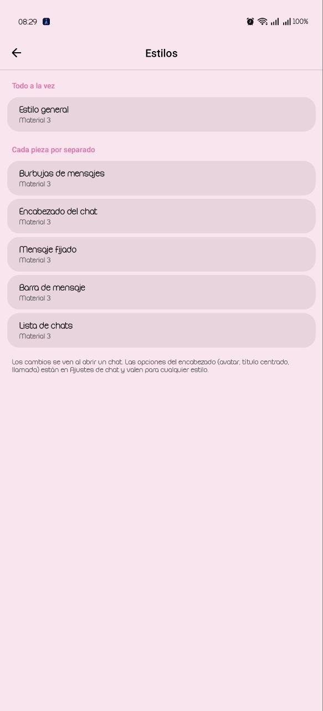
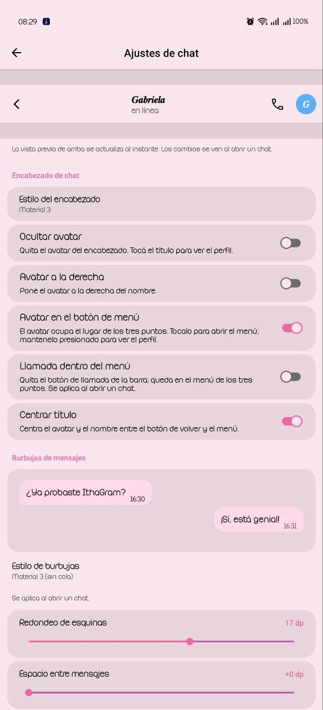

# IthaGram

Cliente **no oficial** de Telegram para Android, basado en el código oficial de [Telegram 13.2.2](https://github.com/DrKLO/Telegram), con un diseño Material 3 y un motor de plugins propio.

> IthaGram no es la app oficial de Telegram ni está afiliada a Telegram.

## Capturas

<table>
  <tr>
    <td align="center"><br><sub>Lista de chats</sub></td>
    <td align="center"><br><sub>Chat</sub></td>
    <td align="center"><br><sub>Plugins</sub></td>
  </tr>
  <tr>
    <td align="center"><br><sub>Itha Ajustes</sub></td>
    <td align="center"><br><sub>Estilos</sub></td>
    <td align="center"><br><sub>Ajustes de chat</sub></td>
  </tr>
</table>

## Qué trae

**Diseño Material 3**
- Lista de chats en tarjetas, con tinte tonal que sigue el color de acento del tema.
- Carpetas como chips (activa rellena, inactivas con contorno).
- Barra inferior flotante (Chats, Contactos, Ajustes, Perfil) y botón flotante tonal.
- Barra de escribir con campo redondeado, ícono de enviar adaptable y botón de Menú de bots integrado.

**Itha Ajustes** (todo lo propio de IthaGram en un solo lugar)
- **Lista de chat:** texto del título, título centrado y barra de búsqueda.
- **Perfil:** ocultar el número de teléfono.
- **Chat:** estilo del encabezado, ocultar el avatar o ponerlo a la derecha o en el botón de menú, llamada dentro del menú, título centrado, redondeo de esquinas y espacio entre mensajes, con vista previa en vivo.
- **Estilos:** elegí el diseño de cada pieza por separado (burbujas, encabezado del chat, mensaje fijado, barra de mensaje y lista de chats) o todo a la vez.
- **Plugins:** gestión de extensiones.

**Plugins**
- Motor de plugins `.plugin` (Python) con pantalla de gestión: instalar, activar, desactivar, actualizar y borrar.
- Pantalla de ajustes por plugin y catálogo en el canal de IthaGram.
- Instalación directa desde un archivo recibido en el chat.

## Descargar

Los APK compilados están en [Releases](../../releases). Para instalar: descargá el APK, permití "instalar apps de orígenes desconocidos" y abrilo.

## Ramas

| Rama | Uso |
|---|---|
| `main` | Versión estable |
| `dev` | Desarrollo |
| `motor-nagram` | Rama de trabajo con el motor de plugins |

Las versiones estables se marcan con tags (por ejemplo `v13.2.2-itha`).

## Compilar

Requisitos (los de Telegram 13.2.2): Android Studio 2025.1.4, Android NDK 27.2.12479018 y Android SDK 36.

1. Cloná el repo con sus submódulos:
   ```bash
   git clone --recursive --shallow-submodules https://github.com/gabrielacjs/IthaGram.git
   ```
   Si olvidaste `--recursive`:
   ```bash
   git submodule update --init --recursive --depth=1
   ```
2. Poné tu propio `release.keystore` en `TMessagesProj/config` y completá `RELEASE_KEY_PASSWORD`, `RELEASE_KEY_ALIAS` y `RELEASE_STORE_PASSWORD` en `gradle.properties`.
3. Compilá desde la terminal:
   ```powershell
   .\gradlew :TMessagesProj_App:assembleAfatRelease
   ```
   El APK queda en `TMessagesProj_App/build/outputs/apk/afat/release/`.

También se puede abrir el proyecto en Android Studio (abrirlo, no importarlo).

**Nota:** para respetar las [compilaciones reproducibles](https://core.telegram.org/reproducible-builds), el repo base trae un `release.keystore` y un `google-services.json` de ejemplo. Antes de publicar tus propios APK, reemplazalos por los tuyos.

## Créditos y licencia

- [Telegram para Android](https://github.com/DrKLO/Telegram), de Telegram FZ-LLC, es la base de este proyecto.
- El motor de plugins se porta de [exteraGram](https://github.com/exteraSquad/exteraGram) y [Nagram](https://github.com/NextAlone/Nagram).
- El diseño del encabezado de chat tipo iOS (título y botones en píldoras flotantes) se inspira en [entinyGram](https://github.com/entaytion/entinyGram) y [Cherrygram](https://github.com/arslan4k1390/Cherrygram).
- Desarrollado por Gabi con la ayuda de [Claude](https://claude.ai), de Anthropic.

Este proyecto se distribuye bajo la misma licencia que Telegram para Android (GNU GPL v2, ver [LICENSE](LICENSE)), y su código fuente se publica para cumplirla.

## Requisitos de Telegram para apps derivadas

Telegram pide a todos los desarrolladores que usan su API y su código:

1. [Obtener tu propio `api_id`](https://core.telegram.org/api/obtaining_api_id).
2. No usar el nombre Telegram en la app, o dejar claro que no es oficial.
3. No usar el logo estándar de Telegram (avión de papel blanco en círculo azul).
4. Leer las [pautas de seguridad](https://core.telegram.org/mtproto/security_guidelines) y cuidar los datos de los usuarios.
5. Publicar el código propio para cumplir con las licencias.

Documentación: [API de Telegram](https://core.telegram.org/api) y [protocolo MTProto](https://core.telegram.org/mtproto).
